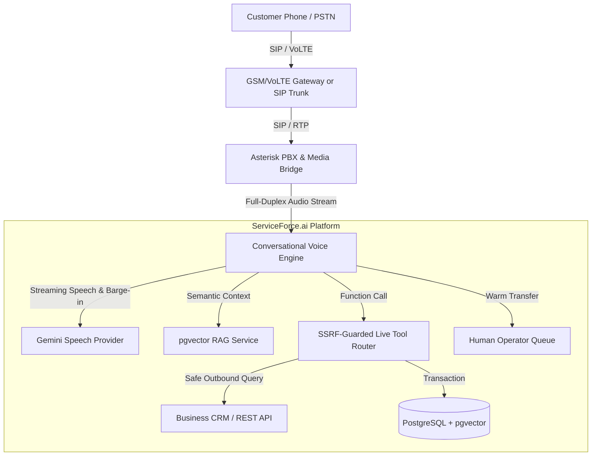

# ServiceForce.ai - Architectural Reference

## 1. System Overview

ServiceForce.ai is an enterprise SaaS platform engineered to connect autonomous AI conversational agents directly to business telephone numbers, live transactional databases, and reference knowledge bases.

---

## 2. Multi-Tenancy & Security Isolation

Every business data record in ServiceForce.ai belongs to a verified tenant identified by `organization_id`.
- Multi-tenancy is enforced at the database and dependency level through `get_tenant_context` in `app/core/deps.py`.
- No cross-tenant access is permitted. Spoofed `X-Organization-Id` headers from users not belonging to the organization return `HTTP 403 Forbidden` with an audit log event.
- Passwords are encrypted with standard `bcrypt` hashing with individual salts.

---

## 3. Streaming Conversational Voice Engine & Barge-In

The conversation loop operates as an asynchronous state machine:
1. **Call Connection:** The telephony adapter emits an answer event.
2. **Greeting Synthesis:** The agent's configured greeting is converted to PCM/Opus audio and transmitted over the media bridge.
3. **Speech Interruption / Barge-In:** Real-time VAD (Voice Activity Detection) monitors the caller's audio channel. If human speech is detected while the agent is speaking, the outgoing audio buffer is immediately flushed within 200ms.
4. **Tool Execution:** When the model calls a tool, the router evaluates permissions, invokes the approved function, and supplies structured output to the model turn.
5. **Human Escalation:** When escalation criteria or customer request triggers `request_human_transfer`, a SIP `REFER` or bridge transfer directs the call to the specified supervisor extension.

---

## 4. Reference Knowledge (pgvector RAG) vs. Live Transactional Data

ServiceForce.ai strictly enforces the architectural boundary between:
- **Reference Knowledge (RAG):** Policies, FAQs, warranties, and operating manuals. Extracted from PDF, DOCX, TXT, and Markdown files and vectorized into 256-dimensional embeddings with cosine similarity matching.
- **Live Transactional Data (Tools):** Inventory, order tracking, appointment availability, and payment balances. Retrieved on-demand through live, typed, SSRF-guarded tool functions. Live data is never hallucinated from embeddings.
